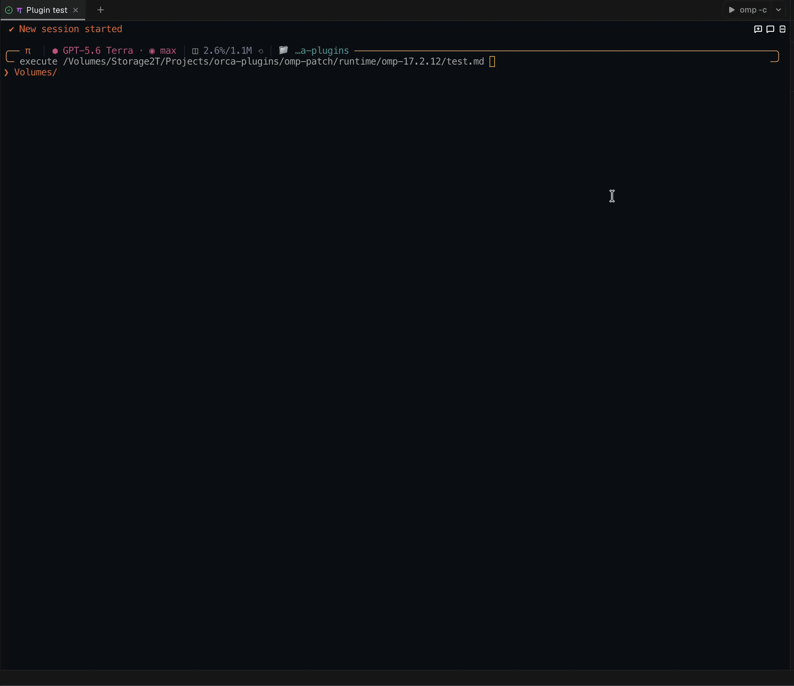

# omp-compact

**English** · [Русский](README.ru.md)


## Install from the Marketplace

You need **OMP 18.17 or later**, from [https://omp.sh/](https://omp.sh/).

```bash
omp plugin marketplace add arksdev/omp-compact
omp plugin install omp-compact@arksdev
```

Restart OMP and turn on the setting the plugin draws through. OMP ships it off, and while it is off every tool call and message keeps OMP's own card; only the stats row still appears:

```text
/settings → Tools → Extensions → Extension Transcript Presenters
```

The plugin never changes this setting itself. If a tool runs while it is off, the plugin shows one warning with the path above.

Then open the plugin settings:

```text
/compact-settings
```

If the menu opens, the plugin is loaded. You only need to add the Marketplace once; after that, update the plugin with:

```bash
omp plugin upgrade omp-compact@arksdev
```

## What the plugin does

During a large task, OMP shows many separate cards: which files it read, what it searched for, which commands it ran, and what it edited. After a few steps, that log becomes long and the important changes are hard to spot.

`omp-compact` makes the log shorter and easier to read:

- while a task is running, it shows each action as one short line and keeps the original order;
- when OMP finishes its answer, it can remove temporary reads, searches, and commands;
- it keeps verified file changes, created Git commits, and final statistics;
- if the task is interrupted or ends with an error and no final answer, it does not hide anything needed for diagnosis;
- it does not replace OMP tools or change permissions, command execution, or results.

Example while OMP is working:

```text
• read src/index.ts
• grep registerTool in src
• bash: bun test
• write: src/app.ts +17|0
• edit: src/theme.css +2|0
```

After a successful answer, the default `live` mode keeps only useful history, with the run's statistics under the answer:

```text
• write: src/app.ts +17|0
• edit: src/theme.css +2|0
• delete: src/legacy.ts -3
• git commit: 1983fsdf34, a4c12de890
<assistant answer>
[ 27 actions · 508.4k prompt (28.2k fresh · 480.2k cached) · 1.3k received · 1h 20m 32s ] — 16:33
```

Delete rows render distinctly: a red `delete` title and a red exact removed stat (`-N`) when the pre-image count is known; when the count is unavailable the stat is omitted entirely.

Some OMP tools are invoked through the same transport as a file write. Such calls no longer look like writes: the row names the device itself and its operation — `github: pr_create` instead of `write: xd://github` — and they are not counted as file changes.

Work in `/vibe` mode is compact: only active worker sessions are listed, not the ones already killed or sitting idle. Each session takes one or two short lines with its state, name, turns taken, how long the current turn has run, the model, and what the session is doing. A session killed or settled more than a few seconds before the call finished is left out, and when nothing is left there is no row at all.

```text
• vibe sessions 2
  ∷ ⟦g⟧ audit-worker 2t grok-4.5 Reported the registry diff
  ╭─ ⠦ ⟦f⟧ wire-vibe 3t+1q 1m12s gpt-5.2-codex Wire the vibe rows
  ╰─ ⠦ edit: Wiring the vibe rows
```

## Before and after

The same kind of OMP session before and after enabling `omp-compact`:

### Without omp-compact

[](docs/assets/before.mp4)

[Open the original MP4](docs/assets/before.mp4)

### With omp-compact

[](docs/assets/after.mp4)

[Open the original MP4](docs/assets/after.mp4)

## Three modes

Choose a mode in `/compact-settings`. The selected mode is fixed for the current logical run, from the moment the agent starts working until its final answer.

| Mode | While OMP is working | After a successful answer | Best for |
| --- | --- | --- | --- |
| `compact` | All supported actions appear as short lines | The entire compact log remains | Keeping a complete action history without large native cards |
| `live` — default | The same complete compact log | File changes, Git summary, and statistics remain; temporary actions are removed | Everyday use: you can watch the process while keeping the transcript clean |
| `clear` | Ordinary tool lines are hidden | The answer, the line with hashes for created commits, and, if enabled, statistics remain | The quietest possible interface |

A tool the plugin has no rule for gets OMP's own one-line summary in every mode, so a new tool is never hidden without a description. Interactive tools such as `ask` keep their full card. `wait` and `todo` show live state, so in `compact` and `live` the newest call keeps its full card while the agent works; older calls become rows, because their cards would only show a frozen copy. A `task` row names its agents and stays after the answer. A block you expand, with `Ctrl+O` or its own toggle in Tern, always shows OMP's full card, including a call the plugin hid and tools whose rows used to stay compact when expanded.

In `compact` and `live`, an abort or error without a final answer preserves the diagnostic log. In `clear` it does not: the quiet view stays quiet through an interrupted turn, and unfinished work is easier to read back in `compact` or `live`. Restored history (a resumed session, `/tree`, `/branch`) is drawn in the mode selected now. In `clear` its tool rows are hidden except the commit summaries, and so are background-job completion notices.

## Additional options

All settings are available through `/compact-settings`. Plugin-only values are stored in `~/.omp/agent/omp-compact/config.json`; profiles and `PI_CODING_AGENT_DIR` change this path according to OMP's normal rules.

The menu is OMP's own settings list: sections, type-to-search, and values that differ from the default drawn in OMP's changed color. Each change is saved at once, as in OMP's `/settings`; `Esc` clears a search, then closes the menu, and one notice confirms what was saved.

### Short file names — `Compact paths`

When enabled, an absolute path inside the current project is shortened:

```text
/Volumes/work/project/src/index.ts:10-20
-> src/index.ts:10-20
```

This changes display only. The plugin does not rewrite tool arguments, files, or stored evidence. External paths, URIs, archive or SQLite selectors, and unsafe paths containing `..` remain unchanged.
`cwd` and `Compact paths` are captured per run: a later run or resize does not relabel existing rows. Newly restored history uses the current display preferences.

JSON:

```json
{ "compactPaths": true }
```

### Git — `Retain Git rows`

The plugin recognizes Git activity from Bash commands that already ran and their results. It does not run hidden `git log`, `rev-parse`, or other probes.

Individual calls and `&&` chains become Git rows. Chains separated by `;` or unescaped newlines remain ordinary Bash: a successful last command does not prove earlier commands succeeded. A quiet commit's hash is confirmed only by a following oneline HEAD log in the same Git context, without filters or other revisions.

- In `live`, Git actions are visible while OMP is working and are replaced after the answer by one line containing verified hashes for created commits.
- A failed commit or a commit without a hash is not included in the final line.
- If you disable this option, `live` shows neither intermediate Git rows nor the terminal Git summary.
- `compact` keeps the complete short Git log regardless of this option.
- In `clear` the intermediate Git rows are hidden with the other ordinary rows, but the line with hashes for created commits stays: created commits are the one thing the quiet view does not hide, an interrupted turn included. Disable the option and that line goes too.
- The newest commit in a series is highlighted with color.

JSON:

```json
{ "retainGitLive": true }
```

### Parallel vibe sessions — `vibe-compact`

This option enables the short view of parallel worker sessions in `/vibe` mode. It is on by default.

Turn it off and those sessions render with OMP's own cards, exactly as if the plugin did not know them: the rows are neither hidden nor replaced by an ordinary short description. The value is frozen for the whole current logical run, so saving settings mid-run never changes the picture halfway through.

JSON:

```json
{ "compactVibeRows": true }
```

### Advisor notes — `Advisor nit/concern`

The option condenses non-blocking advisor notes (`nit`, `concern`, and an omitted severity, which the host documents as a plain nit) to one row per note: `• advisor [nit] <first line>`. It is off by default: without it, advisor cards render exactly as OMP draws them.

The plugin reads the notes from the advisor message itself. A `blocker`, an unknown severity or details it cannot read keep the whole card as OMP draws it. Expanding the card always shows the full note text.

JSON:

```json
{ "compactAdvisorNotes": true }
```

### Per-tool cards — `Tool cards`

The `Tool cards` section lists every tool OMP has loaded, extension tools, MCP tools and `xd://` devices included, and lets you pick how each one is drawn:

- `rows`: one-line rows that follow the mode, like any routine call.
- `newest`: the newest call keeps OMP's full card while the agent works; older calls become rows. This is the default for `wait` and `todo`.
- `open`: OMP's full card in every mode, `clear` included, and after the answer.

A row in the changed color has a saved choice; picking the tool's default again removes the entry. `ask` and the vibe tools are not listed: `ask` needs its card to answer, and the vibe tools have their own switch. A change applies from the next run.

JSON, keyed by tool name (a device by its own name, such as `github`):

```json
{ "tools": { "bash": "open", "wait": "rows" } }
```

### Quick display switch — `alt+c`

`alt+c` works out of the box, with nothing to enable. Each press takes one step around the cycle:

```text
compact → live → clear → off → compact
```

The mode only ever changes between the three enabled states. The plugin switches off only on the step after `clear` and back on only on the step out of off, always into `compact`, so the order does not depend on where you joined the cycle. Switching off keeps the last mode, so a stray press loses nothing.

Each press prints one line naming what will apply, for example `Compact: live — takes effect next run`, or `Compact: off — from the next run` when the plugin goes off.
Rapid presses do not lose steps: reading the current state, computing the transition, and persisting it share the queue used by settings-menu saves.

Two things worth knowing:

- a press applies from the **next** logical run: the settings snapshot is taken once per run, so pressing mid-run never changes the answer already being rendered;
- **changing the chord itself requires restarting OMP**: the agent can register a shortcut but cannot unregister one, so a new chord only starts working after a restart. The menu says so when you close it.

You can change the chord in `/compact-settings` on the `Cycle shortcut` row: `Enter` opens a field, you type the chord as text (`alt+shift+d`, for example), `Enter` saves it and `Esc` goes back. A malformed chord, or one OMP already uses, is rejected with a readable message.

JSON:

```json
{ "displayCycleKey": "alt+c" }
```

### Statistics

`Run statistics` adds one line under the answer of a completed run. You can independently enable actions, sent and received tokens, cache hits, and elapsed time. If any tool failed, the row uses the warning color. `Add local time` appends the local time of the answer beside the row as `— 16:33`; it comes from the instant the turn finished, so restored history reports the time of the answer itself rather than the time of the repaint.

The row appears once the session is idle, so a run that started before then gets its own row after it. It is drawn for you only: the plugin keeps it out of the model's context.

## Safe removal

You can disable the plugin first without uninstalling it:

```bash
omp plugin disable omp-compact@arksdev
```

To remove a Marketplace installation completely:

```bash
omp plugin uninstall omp-compact@arksdev
```

If the plugin is installed in both user and project scope, remove the required copy explicitly:

```bash
omp plugin uninstall --scope user omp-compact@arksdev
omp plugin uninstall --scope project omp-compact@arksdev
```

Restart OMP after uninstalling, and the transcript draws exactly as OMP draws it. You can optionally remove only the plugin's saved settings:

```bash
rm ~/.omp/agent/omp-compact/config.json
```

For a profile, the config is stored at `~/.omp/profiles/<name>/agent/omp-compact/config.json`. You can keep the Marketplace catalog for a future reinstall or remove it separately:

```bash
omp plugin marketplace remove arksdev
```

## Other installation methods

From a Git checkout:

```bash
git clone https://github.com/arksdev/omp-compact.git
cd omp-compact
bun install --frozen-lockfile
bun run omp
```

`bun run omp` loads only `./.omp-plugin/index.ts` through `--no-extensions`, preventing a second copy from loading when the plugin is already installed. For a permanent Marketplace or linked installation, use ordinary `omp` so the rest of your extensions remain enabled. Either way, the `Extension Transcript Presenters` setting from the install section has to be on.

Direct launch for one run:

```bash
omp -e /absolute/path/to/omp-compact/.omp-plugin/index.ts
```

## Compatibility and documentation

The plugin needs **OMP 18.17 or later**. It draws through OMP's public transcript presenter API (`pi.registerTranscriptPresenter`) and patches none of OMP's own classes.

The compact rows also appear in [Tern](https://stencil.so) panes, where OMP hands the transcript to Tern's native view. A compact row there opens OMP's full card with its toggle. In `live` and `clear`, click a turn's stats row to bring back the calls the turn hid, each in its own place; a second click hides them again.

- [Full documentation](docs/FULL-DOCUMENTATION.md)
- [Configuration](docs/CONFIGURATION.md)
- [Architecture](docs/ARCHITECTURE.md)
- [Contributing](docs/CONTRIBUTING.md)
- [Changelog](CHANGELOG.md)

To verify a repository checkout:

```bash
bun install --frozen-lockfile
bun run check
```

## License

[MIT](LICENSE)
