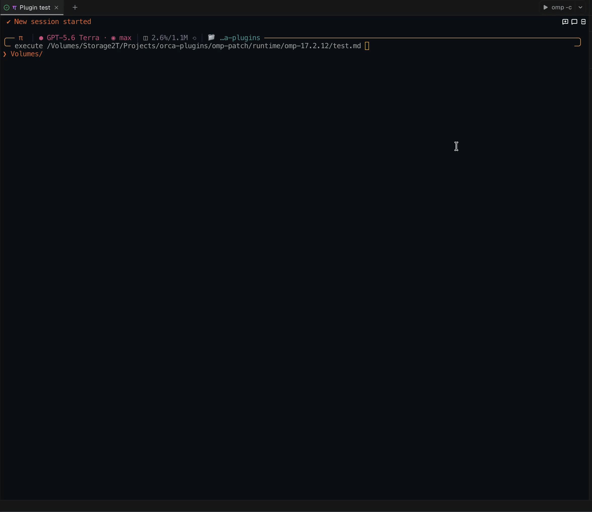

# omp-compact

[English](README.md) · **Русский**


## Установка через Marketplace

Требуется **OMP 18.17 или новее**, см. [https://omp.sh/](https://omp.sh/).

```bash
omp plugin marketplace add arksdev/omp-compact
omp plugin install omp-compact@arksdev
```

Перезапустите OMP и включите настройку, через которую рисует плагин. В OMP она по умолчанию выключена, и пока она выключена, все вызовы инструментов и сообщения рисуются штатными карточками OMP; остаётся только строка статистики:

```text
/settings → Tools → Extensions → Extension Transcript Presenters
```

Сам плагин эту настройку никогда не меняет. Если инструмент запустится, пока она выключена, плагин один раз покажет предупреждение с этим путём.

Затем откройте настройки плагина командой:

```text
/compact-settings
```

Если меню открылось, плагин загружен. Сам Marketplace добавляется один раз; после этого плагин обновляется командой:

```bash
omp plugin upgrade omp-compact@arksdev
```

## Что делает плагин

Во время большой задачи OMP показывает много отдельных карточек: какие файлы он читал, что искал, какие команды запускал и что редактировал. Через несколько шагов такой журнал становится длинным, и важные изменения в нём сложно заметить.

`omp-compact` делает этот журнал короче и понятнее:

- пока задача выполняется, показывает действия по одной короткой строке и сохраняет их порядок;
- когда OMP закончил отвечать, может убрать временные чтения, поиски и команды;
- оставляет подтверждённые изменения файлов, созданные Git-коммиты и итоговую статистику;
- если задача прервалась или завершилась ошибкой без ответа, ничего диагностически важного не скрывает;
- не заменяет инструменты OMP и не меняет разрешения, выполнение команд или результаты.

Пример во время работы:

```text
• read src/index.ts
• grep registerTool in src
• bash: bun test
• write: src/app.ts +17|0
• edit: src/theme.css +2|0
```

После успешного ответа в стандартном режиме `live` остаётся только полезная история, а статистика run стоит под ответом:

```text
• write: src/app.ts +17|0
• edit: src/theme.css +2|0
• delete: src/legacy.ts -3
• git commit: 1983fsdf34, a4c12de890
<assistant answer>
[ 27 actions · 508.4k prompt (28.2k fresh · 480.2k cached) · 1.3k received · 1h 20m 32s ] — 16:33
```

Строки удаления отображаются отдельно: красный заголовок `delete` и красная точная статистика удалённых строк (`-N`) — когда количество известно из pre-image; если количество недоступно, статистика не выводится вовсе.

Часть инструментов OMP вызывается через тот же транспорт, что и запись файла. Такие вызовы больше не выглядят записью: в строке видно само устройство и его операцию — например `github: pr_create` вместо `write: xd://github`, — и в учёт изменений файлов они не попадают.

Работа в режиме `/vibe` компактная: выводятся только активные рабочие сессии, а не уже убитые или простаивающие. На каждую сессию приходится одна‑две короткие строки: состояние, имя, сколько ходов сделано, сколько времени идёт текущий, какая модель и чем сессия занята. Сессия, убитая или завершившая ход больше чем за несколько секунд до окончания вызова, не выводится, а когда показывать нечего, строки нет вовсе.

```text
• vibe sessions 2
  ∷ ⟦g⟧ audit-worker 2t grok-4.5 Reported the registry diff
  ╭─ ⠦ ⟦f⟧ wire-vibe 3t+1q 1m12s gpt-5.2-codex Wire the vibe rows
  ╰─ ⠦ edit: Wiring the vibe rows
```

## До и после

Одинаковый тип сессии OMP до и после включения `omp-compact`:

### Без omp-compact

[](docs/assets/before.mp4)

[Открыть исходное MP4](docs/assets/before.mp4)

### С omp-compact

[](docs/assets/after.mp4)

[Открыть исходное MP4](docs/assets/after.mp4)

## Три режима

Режим выбирается в `/compact-settings` и фиксируется на весь текущий logical run — от начала работы агента до его финального ответа.

| Режим                 | Пока OMP работает                                       | После успешного ответа                                                            | Для чего подходит                                                |
| --------------------- | ------------------------------------------------------- | --------------------------------------------------------------------------------- | ---------------------------------------------------------------- |
| `compact`             | Все поддерживаемые действия показаны короткими строками | Весь короткий журнал остаётся                                                     | Когда нужна полная история действий без больших native-карточек  |
| `live` — по умолчанию | Тот же полный короткий журнал                           | Остаются изменения файлов, Git summary и статистика; временные действия удаляются | Для обычной работы: видно процесс, но transcript остаётся чистым |
| `clear`               | Обычные строки инструментов скрыты                      | Остаётся ответ, строка с hashes созданных commits и, при включении, статистика     | Когда нужен максимально спокойный интерфейс                      |

Инструмент, для которого у плагина нет правила, получает однострочную сводку самого OMP в любом режиме, так что новый инструмент никогда не скрывается без описания. Интерактивные инструменты вроде `ask` сохраняют полную карточку. `wait` и `todo` показывают живое состояние, поэтому в `compact` и `live` у самого нового вызова полная карточка остаётся, пока агент работает; более старые вызовы становятся строками, потому что их карточки показывали бы только застывшую копию. Строка `task` называет своих агентов и остаётся после ответа. Блок, который вы развернули (`Ctrl+O` или его собственным переключателем в Tern), всегда показывает полную карточку OMP, в том числе скрытый плагином вызов и инструменты, чьи строки раньше оставались компактными и в развёрнутом виде.

В `compact` и `live` прерванный или упавший ход без финального ответа сохраняет diagnostic log. В `clear` не сохраняет: спокойный режим остаётся спокойным и на прерванном ходе, а разбирать незавершённую работу удобнее в `compact` или `live`. Восстановленная история (возобновлённая сессия, `/tree`, `/branch`) рисуется в режиме, выбранном сейчас. В `clear` её строки инструментов скрыты, кроме строк с commits, и сообщения о завершении фоновых задач тоже.

## Дополнительные опции

Все настройки доступны в `/compact-settings`. Plugin-only значения сохраняются в `~/.omp/agent/omp-compact/config.json`; при профиле или `PI_CODING_AGENT_DIR` путь меняется по правилам OMP.

Меню — это собственный список настроек OMP: разделы, поиск набором текста, значения, отличные от значения по умолчанию, выделены цветом изменённых настроек OMP. Каждое изменение сохраняется сразу, как в `/settings` самого OMP; `Esc` сначала очищает поиск, затем закрывает меню, и одно уведомление подтверждает сохранение.

### Короткие имена файлов — `Compact paths`

Когда опция включена, полный путь внутри текущего проекта сокращается:

```text
/Volumes/work/project/src/index.ts:10-20
-> src/index.ts:10-20
```

Меняется только отображение. Плагин не переписывает аргументы инструментов, файлы или сохранённые evidence. Внешние пути, URI, archive/SQLite selectors и небезопасные пути с `..` остаются как есть.
`cwd` и `Compact paths` фиксируются отдельно для каждого run: следующий run и resize не переименовывают уже показанные строки. Восстановленная заново история использует текущие настройки отображения.

JSON:

```json
{ "compactPaths": true }
```

### Git — `Retain Git rows`

Плагин распознаёт Git по уже выполненным Bash-командам и их результатам. Он не запускает скрытые `git log`, `rev-parse` или другие проверки.

В Git-строки превращаются отдельные вызовы и цепочки через `&&`. Цепочки через `;` или неэкранированный перевод строки остаются обычным Bash: успешная последняя команда не доказывает успех предыдущих. Hash quiet commit подтверждается только по следующему oneline HEAD-log в том же контексте Git, без фильтров и других revisions.

- В `live` Git-действия видны во время работы, а после ответа заменяются одной строкой с подтверждёнными hashes созданных commits.
- Неуспешный commit или commit без hash в итоговую строку не попадает.
- Если выключить опцию, в `live` не будет ни промежуточных Git rows, ни terminal Git summary.
- В `compact` полный короткий Git-журнал сохраняется независимо от этой опции.
- В `clear` промежуточные Git rows скрыты вместе с остальными обычными строками, но строка с hashes созданных commits остаётся: созданные commits — единственное, что спокойный режим не прячет, в том числе на прерванном ходе. Если опцию выключить, не остаётся и она.
- Самый последний добавленный коммит из серии коммитов выделяется цветом.

JSON:

```json
{ "retainGitLive": true }
```

### Параллельные vibe-сессии — `vibe-compact`

Опция включает короткий вид параллельных рабочих сессий в режиме `/vibe`. По умолчанию она включена.

Если её выключить — эти сессии снова показываются штатными карточками OMP, как если бы плагин их не знал: строки не скрываются и не заменяются обычным коротким описанием. Значение фиксируется на весь текущий logical run, поэтому сохранение настроек посреди работы не меняет картинку на полпути.

JSON:

```json
{ "compactVibeRows": true }
```

### Заметки советника — `Advisor nit/concern`

Опция сворачивает non-blocking заметки советника (`nit`, `concern` и отсутствующий severity — host считает его plain nit) в одну строку на заметку: `• advisor [nit] <первая строка>`. По умолчанию она выключена: без неё карточки советника рисуются штатным OMP один в один.

Плагин читает заметки из самого сообщения советника. `blocker`, неизвестный severity или details, которые он не может прочитать, оставляют карточку целиком такой, как её рисует OMP. Развёрнутая карточка всегда показывает полный текст заметок.

JSON:

```json
{ "compactAdvisorNotes": true }
```

### Карточки по инструментам — `Tool cards`

Раздел `Tool cards` перечисляет все инструменты, загруженные в OMP, включая инструменты расширений, MCP и устройства `xd://`, и для каждого позволяет выбрать вид:

- `rows`: однострочные строки по правилам режима, как у обычного вызова.
- `newest`: самый новый вызов сохраняет полную карточку OMP, пока агент работает; более старые становятся строками. Так по умолчанию рисуются `wait` и `todo`.
- `open`: полная карточка OMP в любом режиме, включая `clear`, и после ответа.

Строка, выделенная цветом изменённых настроек, хранит выбор; если снова выбрать значение по умолчанию для инструмента, запись удаляется. `ask` и инструменты vibe в списке нет: `ask` нужна карточка для ответа, а у vibe есть свой переключатель. Изменение действует со следующего run.

JSON, ключ — имя инструмента (у устройства — его собственное имя, например `github`):

```json
{ "tools": { "bash": "open", "wait": "rows" } }
```

### Быстрое переключение вида — `alt+c`

`alt+c` работает сразу, включать ничего не нужно. Каждое нажатие делает один шаг по кругу:

```text
compact → live → clear → выключен → compact
```

Режим меняется только между тремя включёнными состояниями. Плагин выключается только на переходе после `clear` и включается только на переходе из выключенного, причём всегда в `compact`, поэтому порядок не зависит от того, с какого места вы вошли в круг. При выключении последний режим сохраняется, так что случайное нажатие ничего не теряет.

После нажатия печатается одна строка о том, что применится, например `Compact: live — takes effect next run`, а для выключения — `Compact: off — from the next run`.
Быстрые нажатия не теряют шаги: чтение текущего состояния, вычисление перехода и сохранение идут в одной очереди вместе с сохранениями меню.

Два момента, о которых стоит знать:

- нажатие применяется со **следующего** logical run: снимок настроек берётся один раз на прогон, поэтому нажатие посреди работы не меняет уже отрисовываемый ответ;
- **смена самого сочетания требует перезапуска OMP**: агент умеет регистрировать сочетание, но не умеет снимать регистрацию, поэтому новое начнёт работать только после перезапуска. Меню сообщает об этом при закрытии.

Сочетание можно сменить в `/compact-settings` на строке `Cycle shortcut`: `Enter` открывает поле, сочетание набирается текстом (например `alt+shift+d`), `Enter` сохраняет, `Esc` возвращает к списку. Неверно записанное сочетание или уже занятое OMP меню отклонит с понятным сообщением.

JSON:

```json
{ "displayCycleKey": "alt+c" }
```

### Статистика

`Run statistics` добавляет одну строку под ответом завершённого run. Отдельно можно включать actions, sent/received tokens, cache hit и elapsed time. Ошибка хотя бы одного инструмента отмечается warning color. `Add local time` дописывает справа от строки локальное время ответа в виде `— 16:33`; оно берётся из момента завершения хода, поэтому восстановленная история показывает то же время, что и в момент ответа.

Строка появляется, когда сессия освободилась, поэтому run, начавшийся раньше, получает свою строку после неё. Она рисуется только для вас: в контекст модели плагин её не передаёт.

## Безопасное удаление

Сначала можно просто выключить плагин без удаления:

```bash
omp plugin disable omp-compact@arksdev
```

Для полного удаления marketplace-установки:

```bash
omp plugin uninstall omp-compact@arksdev
```

Если плагин был установлен одновременно в user и project scope, удалите нужную копию явно:

```bash
omp plugin uninstall --scope user omp-compact@arksdev
omp plugin uninstall --scope project omp-compact@arksdev
```

После удаления перезапустите OMP, и transcript рисуется так же, как рисует его сам OMP. По желанию удалите только сохранённые настройки плагина:

```bash
rm ~/.omp/agent/omp-compact/config.json
```

Для профиля config находится в `~/.omp/profiles/<name>/agent/omp-compact/config.json`. Marketplace-каталог можно оставить для будущей переустановки или убрать отдельно:

```bash
omp plugin marketplace remove arksdev
```

## Другие способы установки

Из Git checkout:

```bash
git clone https://github.com/arksdev/omp-compact.git
cd omp-compact
bun install --frozen-lockfile
bun run omp
```

`bun run omp` загружает только `./.omp-plugin/index.ts` через `--no-extensions`, чтобы установленная копия плагина не загрузилась второй раз. Для постоянной marketplace/link-установки используйте обычный `omp`, чтобы остальные extensions оставались включены. В обоих случаях настройка `Extension Transcript Presenters` из раздела об установке должна быть включена.

Direct launch на один запуск:

```bash
omp -e /absolute/path/to/omp-compact/.omp-plugin/index.ts
```

## Совместимость и документация

Плагину нужен **OMP 18.17 или новее**. Он рисует через публичный API OMP для transcript presenters (`pi.registerTranscriptPresenter`) и не патчит собственные классы OMP.

Компактные строки работают и в панелях [Tern](https://stencil.so), где OMP передаёт transcript нативному представлению Tern. Компактная строка там открывает полную карточку OMP своим переключателем. В режимах `live` и `clear` щелчок по строке статистики хода возвращает скрытые вызовы этого хода на их места; повторный щелчок снова их скрывает.

- [Полная документация](docs/FULL-DOCUMENTATION.md)
- [Конфигурация](docs/CONFIGURATION.md)
- [Архитектура](docs/ARCHITECTURE.md)
- [Разработка](docs/CONTRIBUTING.md)
- [Изменения](CHANGELOG.md)

Проверка repository checkout:

```bash
bun install --frozen-lockfile
bun run check
```

## License

[MIT](LICENSE)
